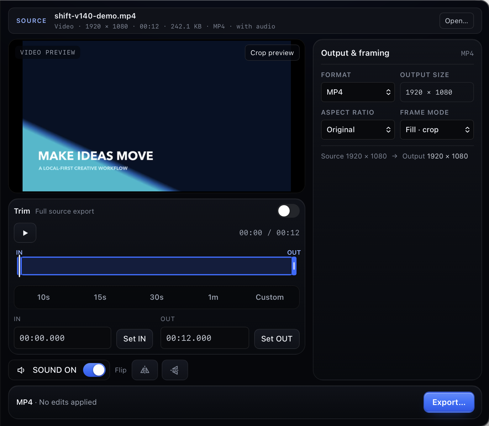
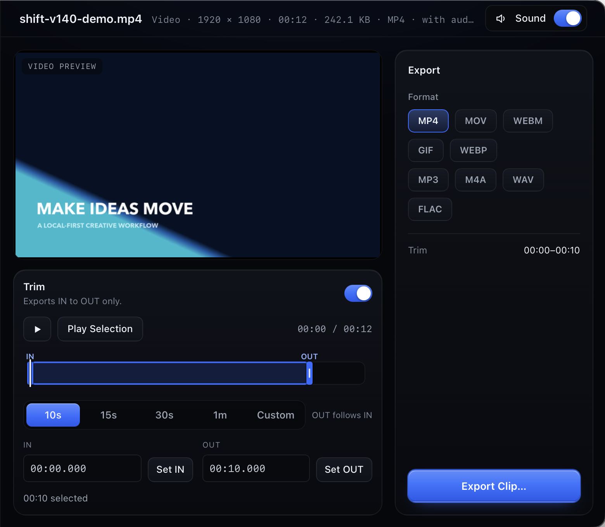
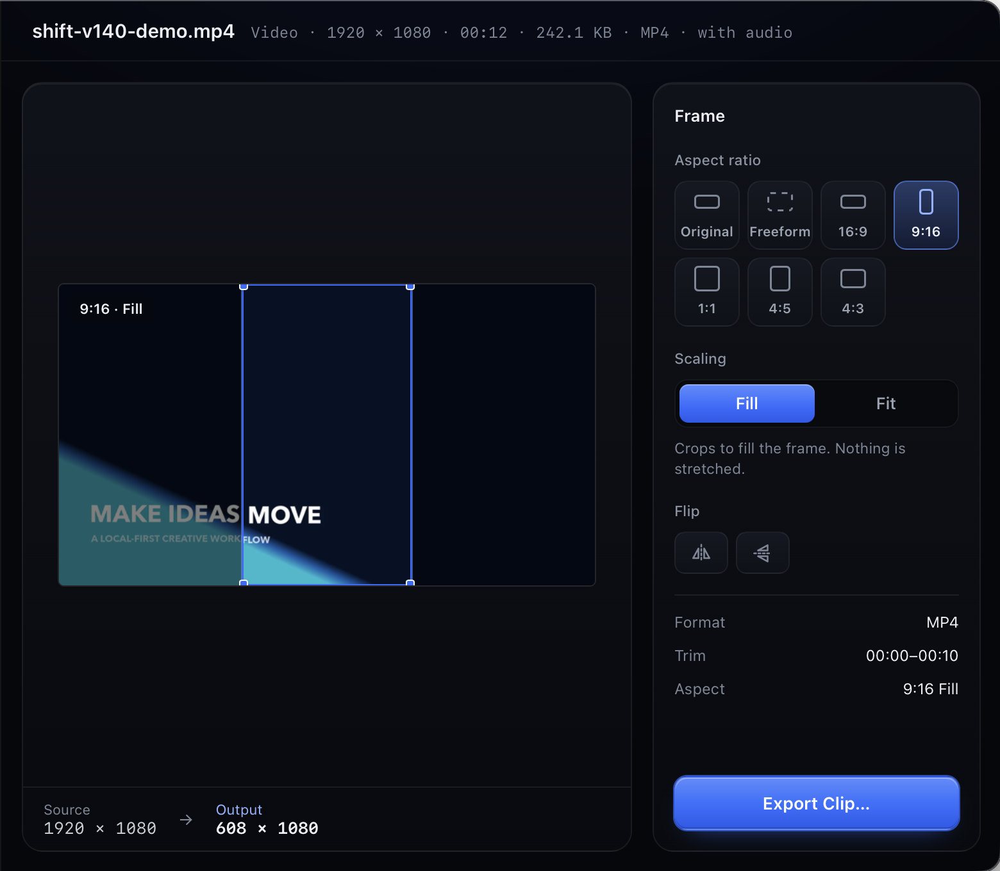
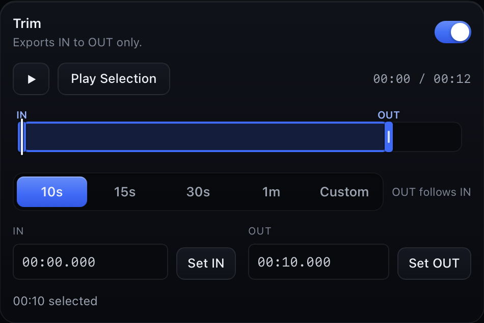
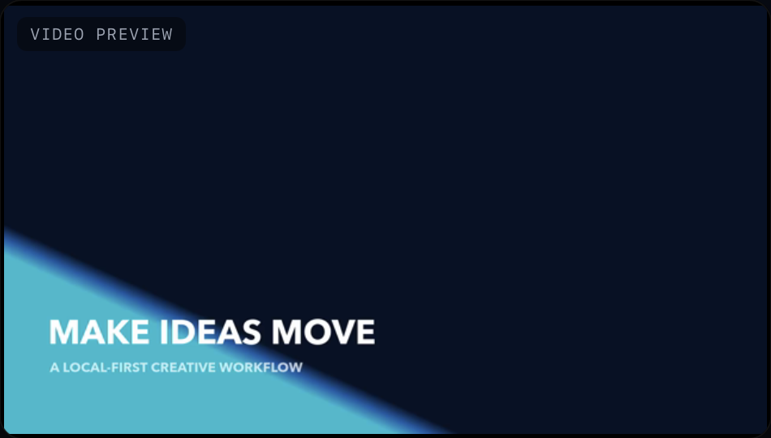

<div align="center">
  
  <h1>SHIFT™</h1>
  <p><strong>Anything in. Anything out.</strong></p>
  <p>A local-first macOS workspace for trimming, reframing, converting and exporting video, audio, images and GIFs.</p>
  <p><strong>v1.4.0 · Apple Silicon</strong></p>
  <p><a href="#screenshots">View screenshots</a> · <a href="#build-locally">Build locally</a> · <a href="#downloads">Download status</a></p>
</div>

<p align="center">
  
</p>

SHIFT brings source, preview, timeline, output format and export into one Dashboard. Open a local file or paste a public media link, make the edits that apply to it, then export. **Download**, **Convert**, **Edit** and **Resize** remain focused views of the same settings.

## Features

- **Edit with context.** Preview video and audio, select an IN/OUT range on the timeline, use 10s, 15s, 30s and 1m presets, and keep the result in a single export workflow.
- **Shape the output.** Change aspect ratio, position a crop, choose Fill or Fit, flip the picture, and keep or remove source sound. The preview and output dimensions show the result before export.
- **Convert local media.** Work with common video, audio and image inputs; export MP4, MOV, WEBM, GIF, animated WEBP, MP3, M4A, WAV, FLAC, JPG, PNG, WEBP and AVIF where they apply. Local image batches can be converted together.
- **Work with public links.** Analyze supported HTTP(S) media through yt-dlp and download or export available items. Site support can change. Only download media you are authorized or legally permitted to use.
- **Stay local.** File transformations run on your Mac. SHIFT has no account, telemetry or cloud upload. Link analysis and downloads require network access; [URL egress limits](docs/URL_EGRESS.md) are documented separately.

## Screenshots

All images below were captured from a running v1.4.0 review build using locally generated demo media. They show actual controls and output, with the macOS screen-recording badge cropped out.

| Focused editor | Portrait reframing |
| --- | --- |
|  |  |

| Timeline | Media preview |
| --- | --- |
|  |  |

[View the Convert screen](docs/screenshots/convert.png) or browse the [full screenshot gallery](docs/screenshots/).

## Downloads

An Apple Silicon release candidate is being validated. **There is no public binary download yet.** The package uses an LGPL FFmpeg build and must be published with its corresponding-source archive. Developer ID signing and notarization remain open. A download link will be added only after both assets are verified on GitHub Releases.

Check [GitHub Releases](https://github.com/mattferre95/shift/releases) for published builds. The current local test package is intended for release validation, not public redistribution.

## Build locally

Requires an Apple Silicon Mac with macOS 12 or newer, Node.js, Rust, Xcode Command Line Tools, CMake, pkg-config, Meson and Ninja.

```bash
npm ci
npm run sidecars
npm run app:build
```

The sidecar script builds the pinned LGPL FFmpeg 9.0.1 variant with WebP support from verified source archives and downloads the pinned yt-dlp 2026.08.19 directory build. It writes the FFmpeg corresponding-source archive beside the binary archive under `src-tauri/target/ffmpeg-lgpl-build/out/`. Sidecars and shared libraries stay outside Git. Tauri writes the app and DMG under `src-tauri/target/release/bundle/`. A local ad hoc signed build is not notarized and is not equivalent to a public Developer ID release.

```bash
npm run app:dev               # development app
npm test                      # frontend tests
cd src-tauri && cargo test    # Rust tests; live network cases are ignored
```

For build or playback problems, verify the sidecars and `ffmpeg-lib/` are present in `src-tauri/binaries/`, then review [architecture and packaging notes](docs/ARCHITECTURE.md). There is no automatic updater or support commitment.

## Credits and license

SHIFT application source: Copyright © 2026 Matt Ferre, [MIT License](LICENSE). The macOS bundle also contains [FFmpeg and ffprobe](https://ffmpeg.org/) and [yt-dlp](https://github.com/yt-dlp/yt-dlp), each under its own license. Exact versions, source material, notices and the public distribution requirements are in [Third-party software and distribution status](docs/THIRD_PARTY_NOTICES.md). The bundled yt-dlp directory retains its packaged dependency notices.

Built with Tauri 2, React, TypeScript and Rust. See the [architecture](docs/ARCHITECTURE.md), [QA checklist](docs/QA_CHECKLIST.md) and [design notes](docs/DESIGN_SPEC.md) for development details.

SHIFT started as a personal everyday media utility. If it is useful to you, [buy me a coffee](https://buymeacoffee.com/mattferre).
